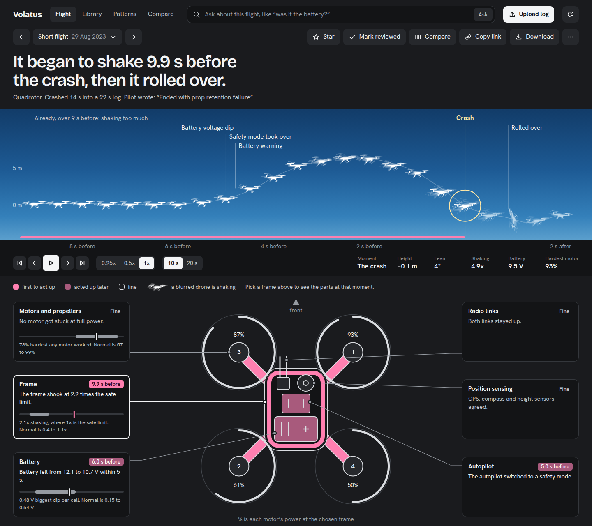
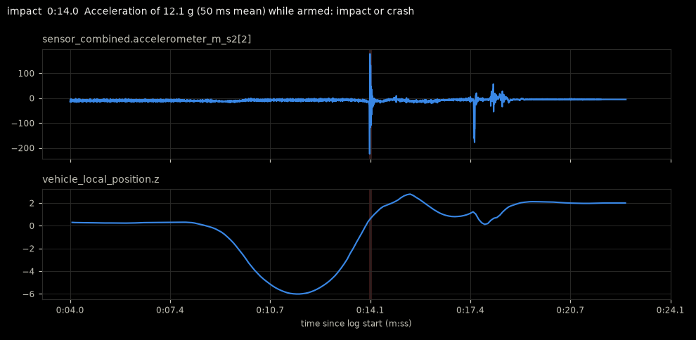
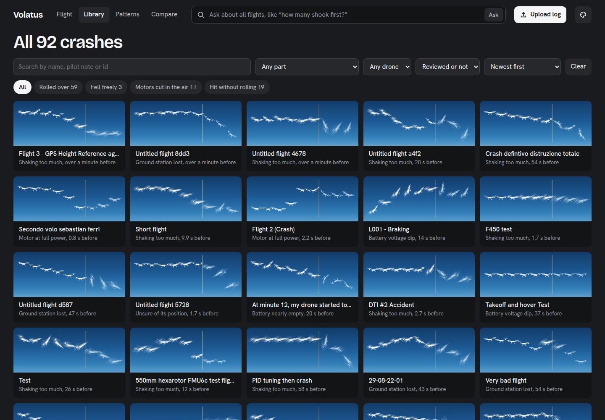
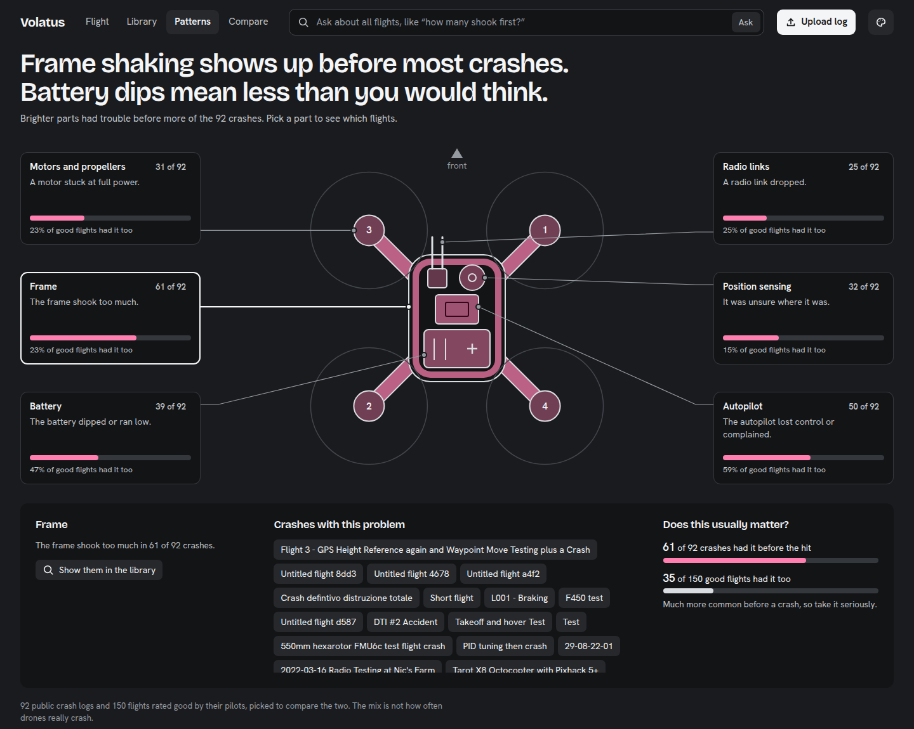
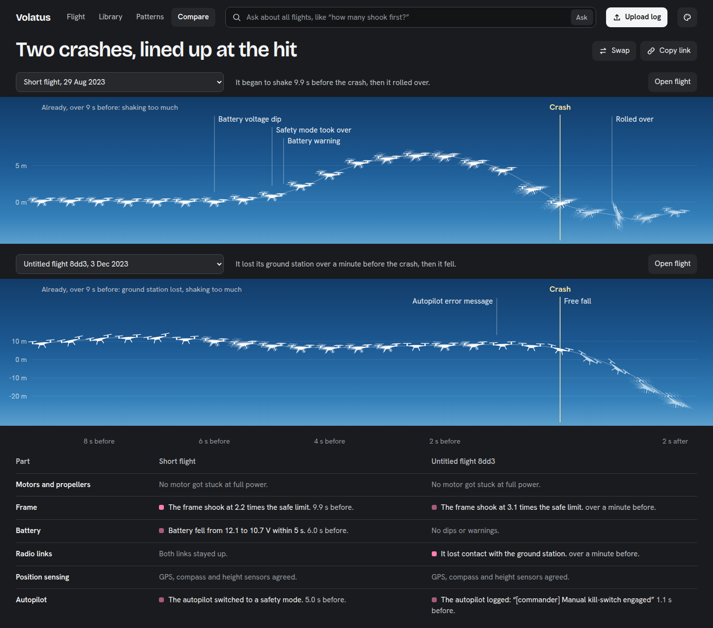

# volatus

Find out why a drone crashed. Volatus reads [PX4](https://px4.io) flight logs (PX4 is an open source autopilot), finds what went wrong and when, and answers questions about it:

- "why did this drone crash?"
- "when did the battery start sagging?"
- "show me all flights with motor saturation before a crash"

Every answer points to timestamped findings and comes with plots of those moments. Fixed rules do the analysis. A language model only writes the final sentences, and only from the findings it is given.



The command line tool and HTTP API work today. The dashboard above is a [design mock](#dashboard-mock), not connected to them yet.

## Example

One real crash, where the pilot wrote "Ended with prop retention failure" (a propeller came off). Shortened:

```console
$ uv run volatus findings 5e002593
  0:04.1-0:19.1  critical vibration         Accel vibration metric reached 26.4 m/s^2 (Flight Review: >4.9 marginal, >9.8 bad)
  0:08.0-0:09.6  warning  battery_sag       Battery voltage sagged 0.48 V/cell (12.1 -> 10.7 V) within 5 s at 2 A
  0:09.0-0:20.2  warning  failsafe          Failsafe triggered (mode at onset: Stabilized)
         0:14.0  critical impact            Acceleration of 12.1 g (50 ms mean) while armed: impact or crash
         0:14.9  critical flip              Vehicle tilted to 98 deg while armed (loss of control or tip-over)
```

`ask` searches those findings, numbers them, and plots them. The impact at 0:14.0 (in PX4, z points down, so the dip is the drone climbing):



## Quick start

Needs Python 3.14 and [uv](https://docs.astral.sh/uv/).

```sh
git clone https://github.com/mohak34/volatus
cd volatus
uv sync
uv run volatus download -n 10    # 10 crash and 10 normal flights
uv run volatus scan              # run the detectors, build data/volatus.db
uv run volatus logs              # list the flights and their ids
uv run volatus findings <id>     # what happened in one of them
```

The evaluation below uses `download -n 150`: 300 logs, about 2.7 GB. The download waits 2 s between files and skips files over 80 MB.

To use your own log, pass the file: `uv run volatus scan path/to/flight.ulg`. Plots are only drawn for logs inside `data/logs`, so copy it there first if you want them.

### Written answers

Findings, search, plots and the API work without a language model. To get written answers too, set a key for any OpenAI-compatible service:

| Variable | Default |
|---|---|
| `VOLATUS_LLM_API_KEY` | none, so no written answer |
| `VOLATUS_LLM_BASE_URL` | `https://api.groq.com/openai/v1` |
| `VOLATUS_LLM_MODEL` | `openai/gpt-oss-20b` |

For Gemini:

```sh
export VOLATUS_LLM_BASE_URL=https://generativelanguage.googleapis.com/v1beta/openai/
export VOLATUS_LLM_MODEL=gemini-3-flash-preview
```

## Commands

Run each with `uv run volatus`. An id can be shortened to its first 8 characters.

| Command | What it does |
|---|---|
| `download -n 150` | Fetch that many crash logs and that many normal logs |
| `scan [files]` | Run the detectors and store the findings |
| `logs` | List logs with their rating and critical count |
| `findings ID` | Timeline of one log. `--all` adds flight mode changes |
| `ask "question"` | Answer from the findings. `--log ID` for one flight, `-k 12` findings to retrieve, `--no-plots` |
| `eval` | Print the evaluation tables |
| `serve --port 8000` | HTTP API on 127.0.0.1 |

Everything is stored in `./data`. Change it with `--data DIR` before the command, or `VOLATUS_DATA`.

## API

| Route | Returns |
|---|---|
| `GET /logs` | All logs |
| `GET /logs/{id}` | One log with its findings |
| `GET /search?q=&log_id=&k=` | Matching findings, best first |
| `POST /ask` with `{"question", "log_id"?, "k"?}` | Answer, cited findings and plot links |
| `GET /plots/{log}/{file}` | A plot as PNG |

The API has no login or rate limit. It listens on the local machine only; do not expose it as it is.

## Dashboard mock

[`design/dashboard.html`](design/dashboard.html) is one file. Download it and open it in a browser. It holds real data from 92 of the crash logs, compared with 150 good flights.

Scripted for now: Ask matches keywords, and Upload opens a sample flight. Stars and notes are saved in your browser only.

**Library.** Every crash, drawn as the last seconds of its flight.



**Patterns.** Which parts had trouble before a crash, and how often good flights had the same trouble.



**Compare.** Two crashes lined up at the moment of impact.



## How it works

1. **Read** (`flight.py`): pyulog loads the topics the detectors need into time series (seconds since log start).
2. **Detect** (`detectors.py`): each detector returns findings with a kind, severity, time window, summary and evidence values.
   - Battery: low voltage per cell, sag under load, PX4 battery warnings.
   - Motors: an output pinned at max (and another at min) on the motor channels only.
   - Vibration: the `vehicle_imu_status` metric with Flight Review's bands on PX4 1.13+, else high-passed accel RMS. Also accel clipping.
   - Crash signs: impact (50 ms mean accel above 5 g), free fall, flip (tilt above 60 deg), disarm in the air.
   - Control and navigation: attitude error vs setpoint, GPS fix and accuracy, EKF innovation test ratios and filter faults.
   - Events: failsafe, RC loss, data link loss, PX4 error messages, CPU overload, and one segment per flight mode.
3. **Index** (`index.py`): findings go into SQLite with an FTS5 table. Each row's text is its summary plus fixed keywords for its kind, so "was vibration a problem?" matches vibration findings. Ranking is BM25 times severity. Findings at or before a log's first crash moment outrank the aftermath. "before a crash" keeps only findings that precede it. Across logs, at most 2 hits per log.
4. **Answer** (`answer.py`): the hits go to the model as numbered lines `[F1] log 5e002593 at 0:04.1-0:19.1 (critical, vibration; 9.9 s before the first detected crash moment) ...`. Citations to ids that were not retrieved are stripped from the reply.
5. **Plot** (`plots.py`): one PNG per cited finding, the finding's signals 10 s either side, its window shaded.

## Evaluation

300 multirotor logs from Flight Review, labeled by their uploaders: 150 rated as crashes (`crash_sw_hw`, `crash_pilot`) and 150 rated good or great. A log counts as flagged if the rule fires anywhere in it.

| Rule (log flagged if...) | Precision | Recall | Accuracy | TP | FP | FN | TN |
|---|---|---|---|---|---|---|---|
| any crash finding (impact, free fall, flip, disarm in air) | 0.82 | 0.65 | 0.75 | 97 | 22 | 53 | 128 |
| any critical finding | 0.73 | 0.77 | 0.74 | 115 | 43 | 35 | 107 |

How often each detector fires per log:

| Finding kind | Crash logs | Normal logs |
|---|---|---|
| vibration | 63% | 23% |
| attitude_error | 62% | 23% |
| motor_saturation | 53% | 23% |
| impact | 52% | 11% |
| flip | 46% | 3% |
| estimator | 45% | 14% |
| battery_sag | 44% | 42% |
| px4_message | 41% | 34% |
| datalink_loss | 36% | 11% |
| disarm_in_air | 27% | 3% |
| failsafe | 27% | 14% |
| accel_clipping | 20% | 1% |
| battery_low | 19% | 14% |
| rc_loss | 15% | 15% |
| battery_warning | 11% | 5% |
| freefall | 5% | 1% |

Reading the numbers:

- Thresholds were tuned on this same set, so these are in-sample numbers, not a held-out score.
- Ratings are user labels. Some "crash" uploads end before the impact is logged, and some "good" flights include hard landings.
- 53 of 150 crash logs show no crash sign at all. These are the detectors' misses; the per-kind table shows what still fires in them.
- Battery sag, PX4 messages and RC loss fire as often in good flights as in crashes. They are context for an answer, not crash predictors, so they are warnings, not critical.

## Tests

```sh
uv run pytest
```

They use two small real logs in `tests/fixtures` and need no key or network.

## Data

Logs come from [PX4 Flight Review](https://review.px4.io), where pilots upload them publicly under CC-BY. They are not in this repository, except for the two test logs and the data drawn in the mock.
